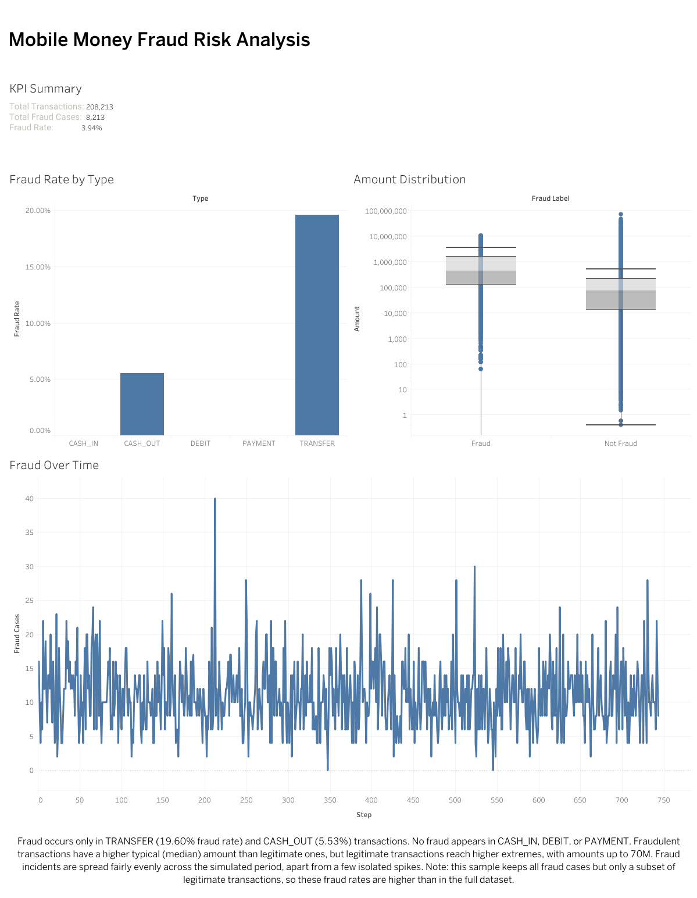

# Mobile Money Fraud Risk Analysis (PaySim + Tableau)

An interactive Tableau Public dashboard exploring where fraud concentrates in a synthetic mobile-money transaction dataset, plus the Python script used to prepare the data.

**Live dashboard:** [Fraud Detection Analytics Dashboard on Tableau Public](https://public.tableau.com/app/profile/shazzad.sakim.sourav/viz/FraudDetectionAnalyticsDashboard/Dashboard1)



## Question

Where is fraud concentrated by transaction type, amount, and time?

## Data

- **Source:** [PaySim Synthetic Financial Datasets for Fraud Detection](https://www.kaggle.com/datasets/ealaxi/paysim1) (Kaggle). The data is synthetic, so no real customer information is involved.
- **Full dataset:** ~6.3M transactions. It is not included in this repo because of its size. Download it from Kaggle.
- **Sample used in the dashboard:** 208,213 rows (all 8,213 fraud cases plus a random 200,000 legitimate transactions).

### Why a sample, and what it means

Fraud is rare in the full dataset. I kept **every** fraud row and downsampled legitimate rows so Tableau Public stays responsive without losing any fraud cases. As a result, **fraud rates in the dashboard (3.94% overall) are higher than in the full dataset** and should be read as relative comparisons, not real-world rates.

## Key findings

- Fraud occurs only in **TRANSFER** (19.60% fraud rate in the sample) and **CASH_OUT** (5.53%). CASH_IN, DEBIT, and PAYMENT show no fraud.
- Fraudulent transactions have a higher **median** amount than legitimate ones (roughly 440K vs 75K), while legitimate transactions reach higher extremes (up to ~70M).
- Fraud incidents are spread fairly evenly across the simulated period (`step` = 1 hour), apart from a few isolated spikes.

## Dashboard contents

| Sheet | What it shows |
|---|---|
| KPI Summary | Total transactions, total fraud cases, overall fraud rate |
| Fraud Rate by Type | Fraud rate per transaction type (acts as a filter for the other sheets) |
| Amount Distribution | Box plot of transaction amounts, fraud vs. not fraud (log scale) |
| Fraud Over Time | Fraud cases per simulated hour |

Note: the amount chart uses a log scale, so records with non-positive amounts (16 in the sample) are not drawn.

## Repository contents

```
├── sample_data.py      # Builds the sampled CSV from the full PaySim file
├── images/             # Dashboard screenshots
└── README.md
```

## Reproduce

1. Download the PaySim CSV from Kaggle and place it in the project folder.
2. Install pandas: `pip install pandas`
3. Run:

```
python sample_data.py --input PS_20174392719_1491204439457_log.csv --output paysim_sample.csv --sample-size 200000
```

The script validates the required columns, keeps all rows where `isFraud == 1`, randomly samples the requested number of non-fraud rows (seeded for reproducibility), and prints a summary of row counts and fraud by transaction type.

4. Load `paysim_sample.csv` into Tableau Public to rebuild the dashboard.

## Tools

Python (pandas), Tableau Public

## Limitations

- Synthetic data. Patterns reflect how the simulator was built and may not match real-world fraud behavior.
- Sampling inflates fraud rates, as described above.
- This is descriptive analysis only. No predictive model is included.
